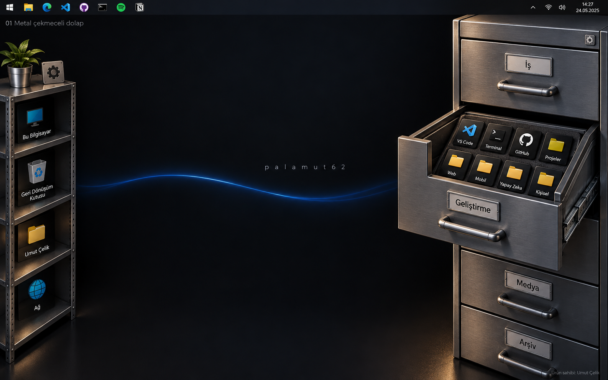
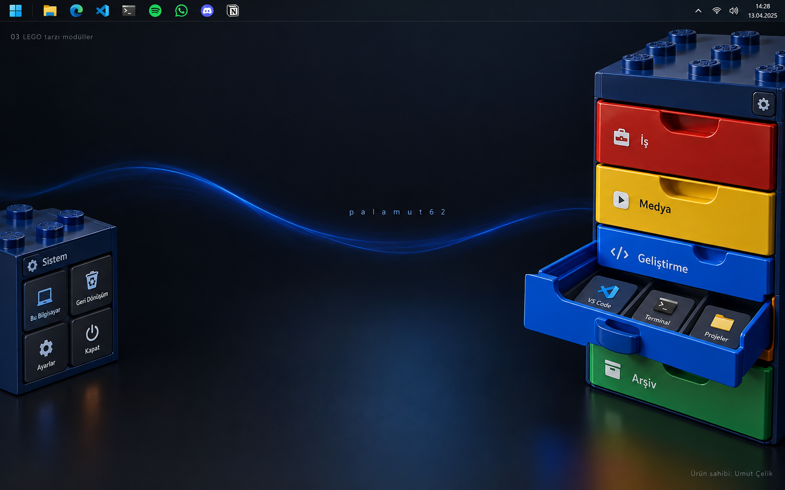

# Masaüstü Dolabı - Ürün Gereksinimleri Belgesi

**Belge sürümü:** 1.0  
**Tarih:** 25 Ekim 2026  
**Durum:** Uygulama geliştirmesine temel olacak PRD taslağı; henüz çalışan ürün değildir.  
**Çalışma adı:** Masaüstü Dolabı; ürün adı uygulama başlangıcında kesinleştirilecek.  
**Ürün sahibi:** Umut Çelik - [X](https://x.com/palamut62) - [GitHub](https://github.com/palamut62)  
**Hedef platform:** Windows 11, ilk sürüm x64.  
**Belge dili ve varsayılan arayüz dili:** Türkçe.

## 1. Ürün özeti

Masaüstü Dolabı, uygulama, dosya ve klasör kısayollarını gerçekçi çekmeceler içinde düzenleyen bir Windows masaüstü uygulamasıdır. Kullanıcı bir kategori çekmecesine tıklar, çekmece animasyonla açılır ve içindeki kısayollar görünür. Bir kısayola tıklamak ilgili hedefi Windows üzerinden açar.

Aynı ürün iki değiştirilebilir görsel şablon sunar: **Metal Dolap** ve **Blok Dolap (LEGO tarzı)**. Temalar ortak veri modelini kullanır. Tema değişiminde kategoriler, öğeler, sıralama ve kullanıcı tercihleri korunur. Metal Dolap başlangıç temasıdır.

Ürün, masaüstü duvar kağıdının üzerine yerleşen fiziksel bir nesne hissi vermelidir. Merkezi çalışma alanı mümkün olduğunca boş kalmalı, dolap ekranın soluna veya sağına yerleştirilebilmelidir. Görsel kalite kadar hızlı erişim, okunabilirlik ve düşük boşta kaynak tüketimi önemlidir.

## 2. Kararlar ve varsayımlar

| Konu | Durum | Karar |
| --- | --- | --- |
| Metal ve LEGO tarzı tasarımlar | Kullanıcı tarafından seçildi | İki ayrı uygulama değil, değiştirilebilir iki tema |
| Kategorili çekmeceler ve hedef açma | Kullanıcı isteği | Temel ürün davranışı |
| Gerçekçi malzemeler ve animasyon | Kullanıcı isteği | Görsel kalite kriteri |
| Önce PRD ve örnek görseller | Bu teslimatın kapsamı | Kodlama veya kurulum bu belgenin parçası değil |
| Varsayılan Metal teması | Önceki önerinin devamı | İlk açılışta kullanıcı değiştirebilir |
| İlk sürüm tek dolap | Önerilen kapsam | Seçilen monitörde bir dolap; çoklu dolap sonraki sürüm |
| Yerel ve çevrimdışı çalışma | Önerilen ürün kararı | Hesap, bulut ve abonelik gerektirmez |
| C++/QML + Qt Quick 3D | Koşullu teknik öneri | Fizibilite ve dağıtım/lisans kararı sonrası kesinleşir |

Bu belgedeki sayısal performans değerleri ölçülmüş sonuç değil, doğrulanacak kabul hedefleridir.

## 3. Tasarım referansları

Görseller önceki konsept çalışmasında imagegen ile oluşturulmuştur. Gerçek çalışan uygulama ekranı değildir; malzeme, ışık, yerleşim ve çekmece davranışı referansıdır. Görsellerdeki görev çubuğu, saat, uygulama ikonları ve duvar kağıdı birebir uygulama gereksinimi sayılmaz. Uygulama kullanıcının gerçek duvar kağıdını ve görev çubuğunu değiştirmez.

### 3.1 Tema A: Metal Dolap

**Görsel yön:** Antrasit çelik gövde, fırçalanmış metal kulplar, hafif yüzey pürüzleri, mekanik raylar, kontrollü yansımalar ve yumuşak gölgeler. Açık çekmecenin içindeki uygulamalar erişilebilir ikon kartları olarak görünür.

**Uygulamaya aktarılacak özellikler:**

- Kapalı durumda kategori adı, kulp, küçük öğe sayacı ve gerektiğinde renk işareti.
- Açıldığında görünür iç tepsi, düzenli ikon ızgarası ve okunaklı etiketler.
- Gövdeye göre ayrı hareket eden çekmece ön yüzü ve iç tepsi.
- Sağ yerleşimde içeriye/sola, sol yerleşimde içeriye/sağa yönelen açık çekmece kompozisyonu.
- Gerçekçilik ikonların ve yazıların okunabilirliğini azaltmamalı.

**Konseptten uyarlama:** Görseldeki dolap sunum amacıyla büyüktür. Üründe ayarlanabilir, daha kompakt olmalıdır. Soldaki bağımsız sistem rafı ilk sürüm için zorunlu değildir; sonraki sürümün aksesuar adayıdır.

### 3.2 Tema B: Blok Dolap (LEGO tarzı)

**Görsel yön:** Birbirine geçen oyuncak blokları çağrıştıran gövde, gerçekçi ABS plastik yüzey, yuvarlatılmış kenarlar, üstte silindirik bağlantı detayları ve kategori renkleri. Kamuya dönük ürün içi tema adı önerisi **Blok Dolap**; tasarımda LEGO logosu kullanılmaz.

**Uygulamaya aktarılacak özellikler:**

- Metal temasıyla aynı kategori ve kısayollar.
- Varsayılan örnek renkler: İş kırmızı, Medya sarı, Geliştirme mavi, Arşiv yeşil.
- Kategori renklerini değiştirme; renk yanında mutlaka yazı veya simge.
- Kısa ve kontrollü esneme hissi; ikona tıklamayı geciktiren abartılı yaylanma yok.
- Oyuncak hissine rağmen yetişkin kullanıcıya uygun temiz, okunaklı görünüm.

### 3.3 Ortak tasarım ilkeleri

1. Dolap bir görsel duvar kağıdı değil, tüm hedeflerin ayrı erişilebilir kontrol olduğu etkileşimli arayüzdür.
2. Ekran görüntüsünü büyük bir resim olarak koyup üzerine görünmez düğmeler yerleştirmek nihai çözüm değildir.
3. İkonlar gerçek hedeflerden alınır; konsept görselindeki ikonlar zorunlu uygulama listesi değildir.
4. Yazılar düz veya çok hafif perspektifli 2D katmanda net kalır.
5. Başlatma, arama ve düzenleme için animasyonun tamamen bitmesini beklemek gerekmez.
6. Dolabın dışında kalan boş alanlar masaüstünü kullanmayı engellemez.

## 4. Kullanıcı ihtiyaçları ve başarı ölçütleri

**Birincil kullanıcı:** Masaüstünde uygulama, proje, belge ve arşiv kısayollarını kategorilerle düzenlemek isteyen Umut.

| İhtiyaç | Kullanıcı hikayesi | Başarı kriteri |
| --- | --- | --- |
| Hızlı erişim | Geliştirme çekmecemi açıp editörümü başlatmak istiyorum | Görünür dolaptan kategori ve hedef için en fazla iki ana tıklama |
| Düzen | Belgeleri ve araçları ayrı tutmak istiyorum | Yeni kategori, yeniden adlandırma ve sıralama kalıcı |
| Görsel kişiselleştirme | Aynı düzeni metal veya blok temasıyla kullanmak istiyorum | Tema değişiminde kimlikler ve sıralar değişmez |
| Masaüstü alanı | Dolap çalışırken ekranımın ortası boş kalsın | Kenara yerleşme, ölçekleme, gizleme ve otomatik gizleme |
| Güvenilirlik | Bilgisayar yeniden başlayınca düzenim geri gelsin | Son başarılı kayıt yüklenir; bozuk kayıt kurtarma yolu vardır |

## 5. Sürüm kapsamı

### 5.1 İlk kullanılabilir sürüm - P0

- Metal ve Blok temaları; uygulamayı yeniden başlatmadan tema değiştirme.
- Tek dolap, birden fazla kategori; kategori oluşturma, düzenleme, silme ve sıralama.
- Uygulama, `.lnk`, yerel dosya, klasör ve HTTP/HTTPS kısayolları.
- Seçmeli masaüstü kısayolu içe aktarma ve sürükle-bırak ile ekleme.
- Kısayol açma, düzenleme, başka kategoriye taşıma ve yalnızca koleksiyondan kaldırma.
- Tüm kategorilerde arama; klavye ile gezinme.
- Sol/sağ kenar, serbest konum, ölçek ve monitör seçimi.
- Çekmece animasyonu, azaltılmış hareket ve düşük kaynak modu.
- Sistem tepsisi menüsü, isteğe bağlı Windows ile başlatma, tek uygulama örneği.
- Yerel kayıt, yedekleme, dışa/içe aktarma ve Türkçe hata durumları.

### 5.2 Sonraki sürüm - P1

- Birden fazla dolap ve monitör başına farklı yerleşim.
- Soldaki sistem rafı veya favoriler rafı gibi aksesuarlar.
- Store uygulamalarını doğrudan keşfetme ve uygulama kimliği üzerinden başlatma.
- Ağ klasörleri ve çıkarılabilir diskler için gelişmiş bağlantı durumu.
- Kullanıcıya ait özel ikon, malzeme ve ses paketleri.
- Birden fazla düzen profili: İş, Kişisel, Oyun.
- İsteğe bağlı çekmece sesleri; varsayılan kapalı.

### 5.3 İlk sürüm dışı

- Windows Explorer veya masaüstü kabuğunu değiştirmek.
- Dosyaları otomatik taşıma, silme veya yeniden adlandırma.
- Bulut senkronizasyonu, hesap sistemi, uzaktan erişim ve tema mağazası.
- Kullanıcının masaüstü ikonlarını otomatik gizleme.
- Sürekli çalışan fizik simülasyonu, duvar kağıdı motoru veya tam ekran 3D oda.
- macOS, Linux, ARM64 ve mobil platform garantisi.
- Kullanıcı tarafından çalıştırılabilir kod içeren tema eklentileri.

## 6. Temel kullanıcı akışları

### 6.1 İlk açılış

1. Kısa karşılama ekranı ürünün kısayolları düzenlediğini açıklar.
2. Metal veya Blok önizlemesi seçilir; başlangıç seçimi Metal.
3. Kullanıcı monitör, sol/sağ kenar ve yaklaşık boyutu seçer.
4. İş, Geliştirme, Medya ve Arşiv örnek kategorileri oluşturulur. Kurulu olmayan uygulamalar sahte kısayol olarak eklenmez.
5. Masaüstü içe aktarma önizlemesi açılabilir veya atlanabilir.
6. Kullanıcı dahil edilecek öğeleri ve hedef kategoriyi seçer. Orijinal dosya ve kısayollar yerinde kalır.
7. Dolap açılır; ilk çekmecede kısa kullanım ipucu gösterilir.

### 6.2 Kısayol açma

1. Kategori kulpuna veya başlığına tek tıklama çekmeceyi açar.
2. Bir ikon üzerinde tek tıklama veya klavyede Enter hedef açma isteğini gönderir.
3. Aynı öğe için kısa süreli tekrar tıklama ikinci başlatmayı engeller.
4. Başlatma isteği sonucu gösterilir. Windows'un isteği kabul etmesi, hedef uygulamanın tamamen açıldığının kanıtı olarak sunulmaz.
5. Varsayılan olarak çekmece açık kalır. Ayarlarda başarılı başlatmadan sonra kapatma seçilebilir.

### 6.3 Yeni öğe ekleme

- Dosya Gezgini'nden çekmeceye bırakmak yalnızca referans ekler; kaynak taşınmaz.
- Kapalı çekmece üzerinde yaklaşık 600 ms bekletilen sürükleme çekmeceyi açar.
- Bırakılan öğeler önce doğrulanır. Çoklu eklemede başarılı ve başarısız sayıları ayrı bildirilir.
- Alternatif yol: çekmecedeki Ekle düğmesi, uygulama içi hedef seçimi veya yol/URL alanı.
- Aynı kategoride aynı hedef ve aynı başlatma parametreleri varsa varsayılan olarak tekrar eklenmez; kullanıcı isterse ayrı adla ekler.
- Aynı hedefin farklı kategorilere eklenmesi desteklenir.

### 6.4 Tema değiştirme

1. Ayarlar > Görünüm ekranında iki tema önizlemesi gösterilir.
2. Kullanıcı seçtiğinde mevcut çekmece etkileşimi güvenli biçimde tamamlanır veya iptal edilir.
3. Yeni varlıklar yüklenir, tema kısa geçişle değiştirilir.
4. Aynı kategori açık kalır; arama metni ve seçili öğe korunur.
5. Yükleme başarısız olursa önceki tema kullanılmaya devam eder; veri kaybı olmaz.

### 6.5 Kategori ve öğe kaldırma

- Öğeyi kaldırmak yalnızca dolaptaki referansı siler. Kaynak dosya veya kurulu uygulama silinmez.
- Son kaldırma için 10 saniyelik Geri al bildirimi gösterilir.
- Boş olmayan kategori silinirken uygulama içi modal, öğeleri başka kategoriye taşıma veya yalnızca bu kategorideki referansları kaldırma seçeneklerini gösterir.
- Modalda etkilenen öğe sayısı açıkça yazılır. İptal seçeneği her zaman bulunur.

## 7. İşlevsel gereksinimler

| Kimlik | Gereksinim | Kabul koşulu |
| --- | --- | --- |
| FR-01 | Kategori yönetimi | Ekle, adlandır, renk/simge değiştir, sırala ve kaldır işlemleri yeniden başlatma sonrası korunur |
| FR-02 | Kısayol yönetimi | Görünen ad hedef dosya adını değiştirmeden düzenlenir; kategori değişimi atomiktir |
| FR-03 | Başlatma | `.exe`, `.lnk`, dosya, klasör ve HTTP/HTTPS örnekleri uygun Windows işleyicisine teslim edilir |
| FR-04 | İçe aktarma | Kullanıcı ve ortak masaüstü konumları sabit yol varsayılmadan bulunur; öğeler önizlemede seçilir |
| FR-05 | Sürükle-bırak | Çoklu öğe ekleme, öğe sıralama ve kategoriler arası taşıma kaynak dosyaları değiştirmez |
| FR-06 | Arama | Ad, kategori ve görünen hedef metninde Türkçe uyumlu arama; sonuçta kategori adı görünür |
| FR-07 | Tema sürekliliği | Tema geçişinde kategori/öğe UUID'leri, sıraları ve başlatma özellikleri aynı kalır |
| FR-08 | Konumlandırma | Sürükleme yalnızca gövde tutma alanından yapılır; konum çalışma alanına sınırlandırılır |
| FR-09 | Görünürlük | Tepsi menüsü ve kullanıcı tarafından değiştirilebilir kısayol ile göster/gizle |
| FR-10 | Kalıcılık | Her tamamlanan düzenleme işlem bazında kaydedilir; çökmede yarım düzen yazılmaz |
| FR-11 | Yedek | Sürümlü dışa aktarma paketi, şema kontrolü ve geri yükleme önizlemesi bulunur |
| FR-12 | Erişilebilirlik | Fare olmadan kategori açma, öğe açma, arama ve ayarlar kullanılabilir |
| FR-13 | Hata yönetimi | Kayıp hedef, erişim reddi, ilişkilendirme eksikliği ve veri hatası ayrı açıklanır |
| FR-14 | Ürün sahipliği | Hakkında ekranında Ürün sahibi: Umut Çelik ve tıklanabilir X/GitHub bağlantıları bulunur |

## 8. Ekranlar ve etkileşim ayrıntıları

### 8.1 Dolap yüzeyi

- Kapalı kategori: ad, kategori simgesi, öğe sayısı, kulp ve odak göstergesi.
- Açık kategori: ikon ızgarası, Ekle, kategori menüsü ve gerekirse kaydırma.
- Her dolapta aynı anda en fazla bir açık çekmece. Başka çekmece seçildiğinde önceki kapanır.
- Kategori sayısı gövdeye sığmazsa gövde uzayıp ekran dışına çıkmaz; kategori bölümü kaydırılır.
- Uzun adlar iki satıra kadar gösterilir; devamı kısaltılır ve odak/hover ile tam ad açılır.
- Bağlam menüsü: Aç, Düzenle, Başka kategoriye taşı, Dosya konumunu aç, Kaldır.
- Dosya konumunu aç seçeneği URL için gösterilmez; sanal hedefler için ayrıca destek doğrulanır.
- Dışarı tıklama varsayılan olarak çekmeceyi kapatır. Sürükleme, modal veya düzenleme sırasında otomatik kapanmaz.

### 8.2 Arama paneli

- Dolap başlığında arama düğmesi; dolap odaktayken Ctrl+F.
- Sonuç satırı: ikon, ad, kategori, kısa hedef ve erişilebilirlik durumu.
- Türkçe I/ı ve İ/i eşlemeleriyle test edilir. Büyük/küçük harf duyarsız eşleme kullanılır.
- En fazla görünen sonuçlar sanallaştırılır; uzun koleksiyonlarda arayüz donmaz.
- Escape önce aramayı temizler, ikinci basış paneli kapatır.

### 8.3 Ayarlar

| Sekme | İçerik |
| --- | --- |
| Görünüm | Tema, ölçek, kategori renkleri, kalite profili, hareketi azalt |
| Yerleşim | Monitör, kenar, serbest konum, konumu sıfırla, otomatik gizle |
| Davranış | Başlatınca çekmeceyi kapat, göster/gizle kısayolu, Windows ile başlat |
| Veri | Seçmeli içe aktarma, dışa aktarma, geri yükleme, yedek durumu |
| Hakkında | Sürüm, ürün sahibi, X/GitHub profil bağlantıları, üçüncü taraf bildirimleri |

Varsayılan otomatik başlatma kapalıdır. Kısayol çakışması durumunda sessizce başka kısayol atanmaz; kullanıcıya alternatif sunulur. Önerilen başlangıç kombinasyonu Ctrl+Alt+D'dir; kayıt başarısı doğrulanır.

### 8.4 Sistem tepsisi

Göster/Gizle, Metal/Blok teması, Ayarlar, Konumu sıfırla ve Çıkış. Ayarlar penceresini kapatmak uygulamayı sonlandırmaz. Çıkış, kaydı tamamlayıp tepsi simgesini ve pencereleri kaldırır.

## 9. Boyut, yerleşim ve Windows davranışı

- İlk açılışta sağ kenar; kullanıcı sol kenarı seçebilir. Yerleşim seçilen monitörün **çalışma alanına** göre yapılır.
- Görev çubuğu üstte, altta veya başka bir kenardaysa kapatılmaz. Referans masaüstündeki üst görev çubuğu özellikle test edilir.
- Başlangıç kapalı gövde genişliği önerisi 240 DIP; açık çekmece dahil yaklaşık 420 DIP. Bunlar prototipte kullanılabilirlik testine göre ayarlanır.
- %75-%150 kullanıcı ölçeği; işletim sistemi DPI ölçeği ayrıca doğru uygulanır. Yükseklik çalışma alanının %80'ini aşınca içerik kaydırılır.
- %100, %125, %150 ve %200 DPI; farklı DPI'lı iki monitör; negatif ekran koordinatları doğrulanır.
- Monitör çıkartıldığında dolap birincil monitörün görünür alanına alınır. Yeniden bağlanmada kullanıcı tercihi korunur.
- Normal modda başka uygulamaların üzerinde sürekli kalmaz. Göster komutu dolabı erişilebilir hâle getirir; otomatik gösterim klavye odağını çalmaz.
- Kullanıcı tarafından seçilebilen Her zaman üstte modu olabilir; varsayılan kapalıdır.
- Tam ekran uygulamada otomatik gizleme tercihine uyulur. Kilit, uyku ve ekran kapanmasında animasyon durur.
- Otomatik gizleme açıkken yaklaşık 10 DIP kenar tutamacı kalır; yaklaşık 250 ms hover ile açılır, 800 ms dışarıda kalınca kapanır. Klavye erişimi de bulunur.
- Görsel olarak saydam piksel, kendiliğinden tıklanabilirlik dışı sayılmaz. Etkileşimli bölgeler için ayrı giriş maskesi/hit-test tasarlanır ve masaüstüne tıklama geçişi test edilir.
- Win+D sonrası görünür kalma ilk sürüm garantisi değildir. İlk fizibilitede davranışı ölçülür ve tepsi/kısayol ile geri çağırma her koşulda sağlanır.
- Belgelenmemiş Explorer/WorkerW pencere hiyerarşisine bağımlı kalıcı masaüstü yerleştirme ilk sürümün temeli yapılmaz.

## 10. Animasyon ve görsel varlık standardı

| Hareket | Metal | Blok | Ortak kural |
| --- | --- | --- | --- |
| Açılma | 280-360 ms, yavaşlayarak durma | 240-320 ms, küçük esneme | Girdi en geç görünür ilk ikonla etkin |
| Kapanma | 220-280 ms | 200-260 ms | Hızlı tekrar tıklamada mevcut konumdan yön değiştir |
| Hover | Hafif kulp/parlaklık değişimi | Hafif renk/parlaklık değişimi | Yerleşim zıplaması yok |
| Tema geçişi | 150-250 ms görsel geçiş | 150-250 ms görsel geçiş | Yeni varlık hazır olmadan eski görünümü kaldırma |
| Azaltılmış hareket | Anlık veya en fazla 100 ms solma | Anlık veya en fazla 100 ms solma | İşlev kaybı yok |

Çekmece durumları: Kapalı, Açılıyor, Açık, Kapanıyor. Sürükleme ve Düzenleme etkileşim kilitleri ayrıca tutulur. Hızlı ardışık tıklama hareketleri kuyrukta biriktirmez; son kullanıcı niyetine doğru devam eder. Odaklanan ikonun ekran konumu animasyonla kullanılamaz hâle gelmemelidir.

Model parçaları: gövde, her çekmecenin ön yüzü, kulp, iç tepsi ve gerekiyorsa ray. Malzeme seti: base color, roughness, metallic ve normal. Blok temasının plastik yüzeyinde metalik değer kullanılmaz. Işık ve gölge öncelikle sabit/önhesaplanmış bileşenlerle düşük maliyetli tutulur.

İlk varlık bütçesi hedefi: tema başına görünür sahnede 100 binin altında üçgen, çoğu doku 1K-2K, toplam sıkıştırılmış tema varlığı 50 MB altında. Gerçek kalite/bellek ölçümleriyle revize edilebilir. Dekoratif bitki ve objeler P0 için şart değildir.

Temalar yalnızca onaylı yerel kaynak ve veri tanımlarından oluşur. Tema değiştirmek kullanıcı koleksiyonunu değiştiren bir işlem çalıştırmaz.

## 11. Teknoloji ve mimari önerisi

### 11.1 Koşullu ana tercih

**C++20 + Qt 6 + QML/Qt Quick + Qt Quick 3D + Windows Shell API + SQLite + CMake.** Tam Qt sürümü ve derleyici geliştirme başlangıcında uyumluluk testinden sonra sabitlenir; bu belge belirli bir güncel sürüm numarası iddia etmez.

Bu ürün için seçim gerekçesi: Qt Quick 3D, 2D arayüz ve 3D sahneyi aynı Qt Quick yapısında birleştirebilir. C++ Windows entegrasyonuna ayrılırken QML görünüm ve animasyon davranışlarını tanımlar. [Qt Quick 3D resmi belge](https://doc.qt.io/qt-6/qtquick3d-index.html)

Metal ve plastik görünümü için fiziksel temelli malzemeler teknik olarak uygundur. Ancak kütüphane tek başına konsept kalitesini üretmez; model, doku, ışık ve kamera çalışması gereklidir. [Qt fiziksel temelli görüntüleme](https://doc.qt.io/qt-6/quick3d-pbr.html)

**Lisans karar noktası:** Qt Quick 3D resmi sayfası modülü Commercial veya GPLv3 olarak tanımlar. Qt'nin tüm modüllerinin aynı lisans koşuluna sahip olduğu varsayılmayacaktır. Kapalı kaynak dağıtım hedefi ve lisans bütçesi netleşmeden bu mimari kesinleştirilmeyecektir. [Modül ve lisans bilgisi](https://doc.qt.io/qt-6/qtquick3d-index.html)

### 11.2 Alternatiflerin değerlendirme çerçevesi

| Aday | Bu ürün açısından değerlendirme | Karar |
| --- | --- | --- |
| C++/QML + Qt Quick 3D | 3D malzeme, animasyon ve yerel entegrasyonu aynı mimaride toplama adayı | Öncelikli fizibilite |
| C# + WPF ve seçilecek 3D katman | Windows uygulama kabuğu için alternatif; gerçekçi görüntüleme ayrıca prototip ister | Qt lisans/teknik kapısı geçilmezse değerlendir |
| Tauri + web tabanlı 3D | Tema geliştirme alternatifi; saydam pencere, hit-test ve kaynak tüketimi ölçülmeli | Yedek aday |
| Oyun motoru tabanlı uygulama | 3D üretime uygun aday; masaüstü yardımcı uygulama davranışı ayrıca doğrulanmalı | P0 için seçilmedi |

Bu tablo performans benchmarkı değildir. Evrensel olarak en kaliteli dil iddiası yerine bu ürünün ihtiyaçlarına uygunluk değerlendirmesidir.

### 11.3 Bileşenler

| Bileşen | Sorumluluk |
| --- | --- |
| AppController | Yaşam döngüsü, tek örnek, başlangıç ve kapanış |
| CabinetView / DrawerController | Sahne, çekmece durumu, odak ve animasyon |
| ThemeManager | Tema manifesti, varlık yükleme, kalite profili ve geri dönüş |
| CollectionService | Kategori ve kısayol iş kuralları, sıralama, doğrulama |
| ShellService | Hedef açma, kısayol çözümleme, ikon ve özel klasör işlemleri |
| DesktopWindowService | Pencere sırası, hit-test, monitör, DPI ve görünürlük |
| ImportService | Masaüstü tarama, önizleme, tekrar kontrolü ve toplu kayıt |
| SearchService | Bellekte arama indeksi ve Türkçe eşleme |
| StorageService | SQLite işlemleri, şema yükseltme ve yedek |
| SettingsView | Görünüm, davranış, veri ve Hakkında ekranları |

UI iş parçacığında disk taraması, ikon çıkarma veya uzun Shell işlemi yapılmaz. COM gerektiren işler uygun başlatılmış iş parçacığında yürütülür. ShellExecuteExW belgesi COM başlatma gereksinimini açıklar. [Microsoft ShellExecuteExW](https://learn.microsoft.com/en-us/windows/win32/api/shellapi/nf-shellapi-shellexecuteexw)

### 11.4 Başlatma kuralları

- Dosya ve klasör açma için Windows Shell'in varsayılan işleyicisi kullanılır. [Microsoft başlatma API açıklaması](https://learn.microsoft.com/en-us/windows/win32/shell/launch)
- `.lnk` için orijinal bağlantı referansı ve çözümlenen hedef ayrı tutulur. Parametre, çalışma dizini ve özel Shell hedefi sıradan dosya yolu gibi kaybedilmez. [Microsoft Shell Links](https://learn.microsoft.com/en-us/windows/win32/shell/links)
- Kullanıcı girdisi `cmd /c` veya PowerShell komut dizisine birleştirilmez. Hedef, parametre ve çalışma dizini ayrı alanlardır.
- Yönetici olarak çalıştırma P0 varsayılanı değildir; uygulama yükseltilmiş yetkiyle sürekli çalışmaz.
- HTTP/HTTPS desteklenir; diğer protokoller ilk sürümde otomatik çalıştırılmaz.
- İçe aktarma ve önizleme hiçbir hedefi kendiliğinden başlatmaz.
- Kaybolan `.lnk` yerine eski çözümlenmiş hedefe sessiz geçiş yapılmaz; onarım önerilir.

## 12. Veri modeli ve saklama

Uygulama verisi kullanıcıya ait LocalAppData altında, geçici ürün adıyla `MasaustuDolabi` klasöründe tutulur. Kurulum klasörü kullanıcı koleksiyonu için kullanılmaz. Gerçek kullanıcı yolu Known Folder API üzerinden çözülür.

| Varlık | Ana alanlar |
| --- | --- |
| Category | id UUID, name, iconKey, color, orderIndex, createdAt, updatedAt |
| Shortcut | id UUID, categoryId, displayName, kind, sourceLinkPath, target, arguments, workingDirectory, iconCacheKey, orderIndex, availability |
| Layout | id, monitorIdentity, edge, normalizedPosition, scale, autoHide |
| Settings | themeId, qualityProfile, reduceMotion, startWithWindows, hotkey, closeAfterLaunch |
| Metadata | schemaVersion, appVersion, lastSuccessfulBackupAt |

- Tema kimliği `metal` veya `blocks`; içerik kayıtları temaya ait dosyalarda tutulmaz.
- Normalleştirilmiş konum monitör geometrisi değişince görünür alana sıkıştırılır; salt piksel koordinatına güvenilmez.
- SQLite yabancı anahtarları ve işlemler etkinleştirilir; kategori silme davranışı iş kuralıyla denetlenir.
- Yeniden sıralama tek işlemde tamamlanır; yarım sıra güncellemesi oluşmaz.
- İlk sürüm hedefi 50 kategori ve toplam 2.000 kısayolda doğrulanmış kullanım. Sınır aşıldığında veri sessizce kesilmez; açık hata gösterilir.
- Son yedi başarılı günlük yedek saklanır. Şema yükseltmeden önce ayrıca yedek alınır.
- Açık veritabanının sıradan dosya kopyası yerine tutarlı SQLite yedekleme mekanizması kullanılır.
- Dışa aktarma: sürümlü JSON ve gerekiyorsa kullanıcı ikonlarını içeren paket. Tema motoru ve çalıştırılabilir dosyalar pakete dahil değildir.
- Geri yükleme: mevcut veri önce yedeklenir, paket doğrulanır, içerik özeti gösterilir ve uygulama içi onaydan sonra atomik değiştirilir. P0'da birleştirme zorunlu değildir.
- Farklı bilgisayardaki geçersiz yollar uyarıyla korunur; içe aktarma sırasında çalıştırılmaz.

## 13. Hata ve boş durumlar

| Durum | Kullanıcıya gösterilecek davranış |
| --- | --- |
| Boş çekmece | Buraya uygulama, dosya veya klasör bırakın; Ekle düğmesi |
| Sonuç bulunamadı | Eşleşme bulunamadı; aramayı temizleme |
| Hedef bulunamadı | Hedef bulunamadı; Konumu güncelle ve Kaldır |
| Erişim reddedildi | Erişim izni yok; hedefi ve sistem izinlerini kontrol etme açıklaması |
| Dosya ilişkilendirmesi yok | Bu dosya türünü açacak uygulama bulunamadı |
| Disk veya ağ hedefi erişilemiyor | Şu anda erişilemiyor; referans korunur, arayüz beklemez |
| Tema yüklenemedi | Önceki tema geri gelir; Tekrar dene ve düşük kalite seçeneği |
| Veritabanı okunamıyor | Hatalı dosya korunur; yedekten kurtarma veya yeni koleksiyon seçimi |
| Kayıt yazılamıyor | Kaydedilemedi bildirimi; değişikliğin kalıcı olmadığı açıkça belirtilir |
| İçe aktarmada kısmi hata | Eklenen, atlanan ve başarısız öğeler ayrı sayılır |

Ürün kaynaklı uyarılar uygulama içi modal veya toast olarak gösterilir. İşletim sisteminin kendi izin ve dosya açma akışlarının denetimi uygulamaya aitmiş gibi sunulmaz.

## 14. Erişilebilirlik ve kullanılabilirlik

- Tab/Shift+Tab ile sıralı gezinme; Enter/Space ile açma; Escape ile panel/çekmece kapatma.
- Her ikon için erişilebilir ad, kategori ve işlem açıklaması.
- İşletim sistemi ekran okuyucusu ile temel gezinme gerçek cihazda test edilir. 3D nesnenin varlığı tek başına erişilebilirlik sağlamaz; karşılık gelen semantik kontrol gerekir.
- Odak halkası her iki temada görünür. Renk tek anlam taşıyıcısı olamaz.
- Normal metin için en az 4.5:1 kontrast tasarım hedefi.
- Etkileşim alanı en az 40x40 DIP; ana ikonlarda 48x48 DIP veya üzeri tercih edilir.
- Hareketi azalt tercihi ilk açılışta sistem tercihinden alınır, kullanıcı değiştirebilir.
- Perspektif ve ışık etiketlerin okunabilirliğini bozarsa 2D okunaklı katman önceliklidir.

## 15. Performans ve kalite hedefleri

Referans kabul cihazı geliştirme başında kaydedilir: Windows sürümü, CPU, GPU/sürücü, RAM, ekran çözünürlüğü ve DPI. Kullanıcının bilgisayarının bu özellikleri bu belge hazırlanırken ölçülmemiştir. Başlangıç test profili: 16 GB RAM, SSD, entegre GPU, 1920x1080 ve 2560x1440.

| Ölçüt | Hedef | Ölçüm |
| --- | --- | --- |
| İlk kullanılabilir açılış | SSD üzerinde en fazla 3 saniye | 10 soğuk açılışın p95 değeri |
| Çekmece hareketi | 60 FPS hedefi; p95 kare süresi en fazla 20 ms | Her temada 100 aç/kapat, standart kalite |
| Girdi geri bildirimi | En fazla 100 ms | Tıklama ile ilk görsel değişim arası |
| Boşta CPU | 60 saniyelik ortalamada %1 altında hedef | Sabit sahne, arama ve tarama yok |
| Boşta GPU | Sürekli render döngüsü yok | Sabit sahnede gereksiz frame üretimi izlenir |
| Bellek | Standart temada 300 MB altında süreç private bytes hedefi | 2.000 öğe, 10 dakika kullanım |
| Arama | 2.000 öğede p95 en fazla 100 ms | İndeks hazırken sonuç güncelleme |
| Tema değişimi | İlk yüklemede en fazla 2 saniye | Soğuk ve sıcak geçiş ayrı raporlanır |
| Sağlamlık | 500 çekmece çevrimi ve 50 tema değişiminde çökme yok | Bellek artışı ve bozuk durum ayrıca kontrol edilir |

Gizliyken çizim durur. Hareket bitince yalnızca değişen sahne yeniden çizilir. Düşük kaynak modunda dinamik gölge, ağır yansıma ve yüksek çözünürlüklü dokular azaltılır. 3D başlatılamazsa aynı koleksiyona erişim sağlayan sade 2D liste görünümü sunulur. Bu geri dönüş gerçekçi tema deneyiminin eşdeğeri olarak raporlanmaz.

## 16. Gizlilik, güvenlik ve veri bütünlüğü

- Koleksiyon yereldir; hesap ve telemetri gerektirmez. Kullanıcı seçmeden dosya yolları veya uygulama listesi dışarı gönderilmez.
- Hedefler yalnızca kullanıcı açma eylemiyle çalışır. İçe aktarma, tema geçişi ve geri yükleme başlatma yapmaz.
- Özel uygulama logları hata ayıklama için yereldir; tam kişisel yol ve parametreler varsayılan olarak maskelenir. Dönen log bütçesi 10 MB.
- Tema manifestleri yol geçişi ve dış kaynak yükleme açısından doğrulanır; çalıştırılabilir eklenti kabul edilmez.
- İçe aktarılan paketlerde boyut, dosya türü, şema sürümü ve klasör dışına yazma kontrol edilir.
- Koleksiyondan kaldırma işlemi dosya sistemi silme işlemine dönüşmez.
- Dosya adı, kısayol açıklaması veya tema metni uygulama komutu olarak yorumlanmaz.

## 17. Kabul testleri

| Test | Senaryo | Beklenen sonuç |
| --- | --- | --- |
| AT-01 | Metal temada dört kategori ve 30 öğe oluştur, Blok'a geç, yeniden başlat | Aynı kimlikler, hedefler, kategoriler ve sıra |
| AT-02 | `.exe`, parametreli `.lnk`, belge, klasör ve HTTPS aç | Doğru hedef/işleyici; çalışma dizini ve parametreler korunur |
| AT-03 | Boşluk ve Türkçe karakter içeren hedef aç | Hedef parçalanmaz; yanlış komut yürütülmez |
| AT-04 | 20 öğeyi çekmeceye sürükle | Kaynaklar yerinde; sonuç sayıları doğru |
| AT-05 | Kısayol ve dolu kategori kaldır; Geri al kullan | Yalnızca referanslar etkilenir; geri alma doğru |
| AT-06 | Hedefi dışarıdan taşı veya sil | Türkçe hata, onarım yolu, çökme yok |
| AT-07 | Açık çekmece sırasında hızla 20 kez tıkla | Son niyetle tutarlı tek durum; animasyon kuyruğu yok |
| AT-08 | Üst görev çubuğu, farklı DPI ve iki monitör | Taşma, bulanık etiket veya hatalı hit-test yok |
| AT-09 | Dolabın saydam çevresindeki masaüstü ikonuna tıkla | Alttaki ikon normal çalışır; dolap boş alanı yutmaz |
| AT-10 | Monitörü ayır, uyut/uyandır, Explorer'ı yeniden başlat | Dolap geri çağrılabilir, tepsi yinelenmez, veri korunur |
| AT-11 | Sadece klavyeyle kategori aç, ara, hedef aç, tema değiştir | Temel işlemler fare gerektirmez |
| AT-12 | Hareketi azalt ve düşük kalite aç | Aynı işlevler, erişilebilir ikonlar, sınırlı hareket |
| AT-13 | Yazma sırasında süreci sonlandır, yeniden başlat | Veritabanı tutarlı; son tamamlanan işlem korunur |
| AT-14 | Geçerli ve bozuk yedek paketlerini yükle | Geçerli veri geri gelir; bozuk paket mevcut veriyi bozmaz |
| AT-15 | 2.000 öğe ile arama ve çekmece açma | Tanımlı performans bütçeleri ölçülür |
| AT-16 | Kurulu uygulamayı güncelle, sonra kaldır | Güncellemede koleksiyon korunur; kaldırmada veri tercihi açıklanır |
| AT-17 | Windows ile başlatmayı aç/kapat | Yeniden oturum açmada tercih uygulanır; çift örnek oluşmaz |
| AT-18 | Uygulama hedefi Shell tarafından kabul edilir ama açılması gecikir | Tamamen açıldı şeklinde yanlış başarı iddiası yok |

## 18. Geliştirme aşamaları ve geçiş kapıları

### Aşama 0 - Fizibilite ve teknoloji kesinleştirme

Tek çekmeceli prototipte saydam pencere, tıklama geçişi, görev çubuğu, odak, çoklu DPI, Shell başlatma ve boşta render davranışı ölçülür. Metal ve plastik malzeme örneği aynı sahnede denenir. Qt Quick 3D lisansı ile hedef dağıtım modeli karara bağlanır.

**Çıkış kriteri:** AT-08/09'un temel örnekleri, gerçek kısayol açma ve referans cihaz ölçümleri başarılı; başarısızsa alternatif mimari kararı gerekçesiyle kaydedilmiş.

### Aşama 1 - İşlevsel çekirdek

Koleksiyon modeli, SQLite, kategori/öğe düzenleme, ShellService, içe aktarma, arama ve hata yönetimi. Geçici sade arayüz kullanılabilir.

**Çıkış kriteri:** AT-02/03/04/05/06/13/14 geçer; kaynak dosyalara istenmeyen yazma yok.

### Aşama 2 - Metal tema

Üretim varlıkları, çekmece durum makinesi, ikon tepsisi, sağ/sol yerleşim ve okunaklı etiketler.

**Çıkış kriteri:** Gerçek ekran görüntüsü konseptle karşılaştırılır; AT-07 ve performans bütçesi sağlanır.

### Aşama 3 - Blok tema ve tema sürekliliği

Aynı veri ve etkileşim sözleşmesi üzerinde plastik malzeme, kategori renkleri ve tema geçişi.

**Çıkış kriteri:** AT-01 geçer; iki temada tüm P0 işlevler eşdeğer.

### Aşama 4 - Masaüstü ürünü olarak tamamlama

Tepsi, otomatik başlatma, monitör geçişi, klavye erişimi, düşük kaynak modu, yedek ve kurulum.

**Çıkış kriteri:** AT-08 ile AT-18 arasındaki ilgili testler ve görsel kabul tamamlanır.

### Aşama 5 - Teslimat

Kaynak doğrulaması, paket üretimi, kurulum ve kurulu EXE testi ayrı raporlanır. Yalnızca derlemenin başarılı olması ürünün kurulu ortamda çalıştığı anlamına gelmez.

**Çıkış kriteri:** Temiz kullanıcı hesabında kurulum, açılış, iki tema, hedef başlatma, yeniden oturum açma ve kaldırma doğrulanmış; bilinen sorunlar yazılmış.

## 19. Dağıtım ve geliştirme çalışma düzeni

- Kaynak proje ileride `C:\Users\umuti\projects\masaustu-dolabi\` altında oluşturulabilir; bu PRD teslimatı kendi başına kaynak proje kurulumu değildir.
- Kaynak yapı: uygulama çekirdeği, Windows platform katmanı, QML görünümü, tema varlıkları ve testler ayrılır.
- Kurulum kullanıcı düzeyinde ve normal çalıştırma yönetici gerektirmeyecek şekilde hedeflenir.
- Gerekli çalışma zamanı ve Qt modülleri paketlenir; kullanıcının geliştirme araçlarını kurması beklenmez.
- Kurulum kullanıcı verisinin üzerine yazmaz. Güncelleme öncesinde şema geçişi ve yedek kontrol edilir.
- İlk sürümde otomatik güncelleme şart değildir; sürümlü kurulum paketi yeterlidir.
- Kaynak push, sürüm yayını, kurulum ve kurulu uygulama doğrulaması uygulama geliştirme aşamasında ayrı teslimat adımlarıdır.
- Projede DURUM.md, yerel talimat dosyaları ve uzun soluklu mimari için PROJE-REHBER.md tutulur; AI araç talimatları ürün deposuna yayımlanmaz.

## 20. Açık kararlar ve riskler

| Konu | Mevcut öneri | Ne zaman çözülmeli? |
| --- | --- | --- |
| Ürün adı | Masaüstü Dolabı çalışma adı | Proje başlangıcında |
| Dağıtım ve lisans | Qt Quick 3D koşullarıyla uyumlu model | Aşama 0 bitmeden |
| Gerçek 3D görsel bütçesi | Optimize edilmiş model/doku ve sabit ışık | Aşama 0 ölçümüyle |
| Win+D görünürlüğü | Geri çağırma garantisi; sürekli görünürlük garantisi yok | İlk Windows prototipinde |
| Sol sistem rafı | P1 aksesuar | P0 tamamlandıktan sonra |
| Çoklu dolap | P1 | Tek dolap kullanımı doğrulanınca |
| Kullanıcının GPU/DPI profili | Henüz ölçülmedi | İlk yerel prototipten önce |
| İmzalı kurulum | Dağıtım kanalına göre karar | Yayın hazırlığında |

Başlıca teknik riskler: saydam görüntü ile giriş maskesinin uyuşmaması, 3D metin okunabilirliği, boşta GPU tüketimi, DPI geçişinde ikon hedeflerinin kayması ve `.lnk` özelliklerinin kaybolması. Her biri ilgili kabul testiyle takip edilir. Konsept görselinin birebir fotoğraf kalitesi, çalışan uygulama ölçümü yapılmadan vaat edilmez.

## 21. Tamamlanmış ürün tanımı

İlk sürüm, her iki temada aynı koleksiyonu güvenle kullanabildiğinde; kategoriler ve kısayollar düzenlenip kalıcı saklandığında; gerçek uygulama, dosya ve klasörler açıldığında; masaüstünün boş bölgeleri kullanılabilir kaldığında; animasyon ve erişilebilirlik hedefleri karşılandığında; kurulu EXE üzerinde kabul testleri tamamlandığında bitmiş sayılır.

## Ek A - Görsel dosyaları

- `assets/01-metal-dolap.png`: Seçilen 1 numaralı Metal Dolap konsepti.
- `assets/03-blok-dolap.png`: Seçilen 3 numaralı LEGO tarzı Blok Dolap konsepti.

Görseller Markdown içindeki göreli bağlantılarla eklenmiştir. Belgeyi taşırken `assets` klasörünü yanında tutun; ZIP paketi bu yapıyı korur.

## Ek B - Teknik kaynaklar

25 Ekim 2026 tarihinde başvurulan resmi kaynaklar:

1. [Qt Quick 3D, modül ve lisans bilgisi](https://doc.qt.io/qt-6/qtquick3d-index.html)
2. [Qt fiziksel temelli görüntüleme](https://doc.qt.io/qt-6/quick3d-pbr.html)
3. [Qt Quick Window türü](https://doc.qt.io/qt-6/qml-qtquick-window.html)
4. [Microsoft ShellExecute / ShellExecuteEx ile başlatma](https://learn.microsoft.com/en-us/windows/win32/shell/launch)
5. [Microsoft ShellExecuteExW API](https://learn.microsoft.com/en-us/windows/win32/api/shellapi/nf-shellapi-shellexecuteexw)
6. [Microsoft Shell Links](https://learn.microsoft.com/en-us/windows/win32/shell/links)

Kaynaklar API yeteneklerine dayanak sağlar. Ürüne özel yerleşim, süre, kapsam, performans bütçesi ve mimari tercihleri bu PRD'nin tasarım önerileridir.
