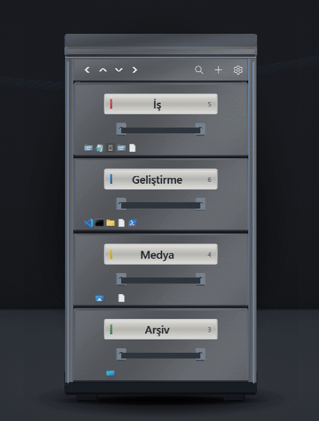
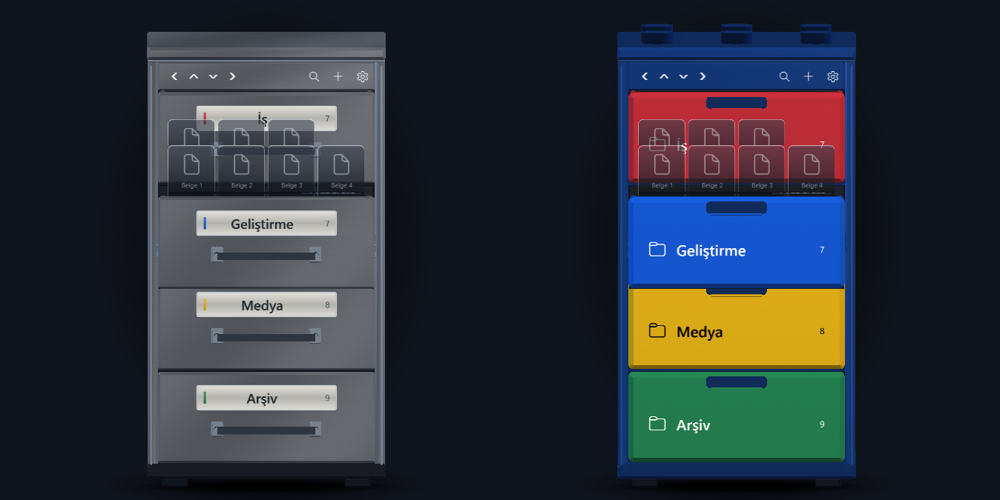

<h1 align="center">Masaüstü Dolabı · Desktop Cabinet</h1>
<p align="center">Organize apps, files, folders and links in realistic 3D drawer cabinets that stand right on your Windows desktop.</p>
<p align="center">
  <a href="#getting-started">Getting started</a> · <a href="#features">Features</a> · <a href="#türkçe">Türkçe</a>
</p>
<p align="center">
  
  
  
  
  
</p>

<p align="center"></p>

<p align="center"></p>

## Table of Contents

- [Features](#features)
- [Getting started](#getting-started)
- [Usage](#usage)
- [Project structure](#project-structure)
- [Testing](#testing)
- [Privacy and safety](#privacy-and-safety)
- [License](#license)
- [Türkçe](#türkçe)
- [Product owner](#product-owner)

## Features

- **Real 3D cabinets** – two themes: brushed **Metal** and toy-like **Block** (LEGO-style, no LEGO branding). Drawers slide out with material-specific sounds; shortcuts stand inside like filing cards (first click lifts, second click opens).
- **Multiple cabinets** – up to 6, each with its own theme, position, monitor, scale, rotation and design (body color, handle, label style, module: standard / slim / wide / large drawers).
- **Placement** – drag anywhere, magnetic snapping to screen edges and other cabinets, layout lock, depth-based auto size, 3D rotation with arrows or mouse.
- **Smart drawers** – recent downloads, recently opened, changed this week; **folder-linked drawers** that mirror a folder live; **project drawers** (folder, terminal, editor, notes, sites) with *Open all*.
- **Work sets & time machine** – save named layouts (Work, Code, Games) and switch from the tray; automatic layout history with restore.
- **Quick preview** – press Space on a shortcut: images, text, PDF first page, folder contents.
- **Drop shelf** – a temporary tray for files, links and pasted screenshots, then move them into drawers.
- **Sections, search, drag & drop reorder**, broken-shortcut detection and bulk path remapping for moving to another PC.
- **Desktop extras** – live system monitor (CPU, GPU, RAM, disk, top processes), themed wallpaper, optional hiding of desktop icons, tray-only (no taskbar button), global hotkey `Ctrl+Alt+D`.

## Getting started

Requirements: Windows 10/11 x64 and the [.NET 8 SDK](https://dotnet.microsoft.com/download/dotnet/8.0) (runtime is enough to run a published build).

```bash
git clone https://github.com/palamut62/DesktopOrganizer.git
cd DesktopOrganizer
dotnet build src/Dolap.App
dotnet run --project src/Dolap.App
```

Create a local install (per-user, no admin):

```bash
dotnet publish src/Dolap.App -c Release -r win-x64 --self-contained false -o "%LOCALAPPDATA%\Programs\MasaustuDolabi"
```

## Usage

| Action | How |
| --- | --- |
| Open a drawer | Click its front |
| Open a shortcut | Click once to lift, click again (or press Enter) |
| Preview | Select a card and press Space |
| Add items | Drag files/folders/links onto a drawer, or use **+ Kısayol ekle** |
| New drawer | **+** in the cabinet header (empty, project, or smart drawer) |
| Show / hide all | Tray icon or `Ctrl+Alt+D` |
| Settings | Gear icon or tray menu |

All data lives in `%LOCALAPPDATA%\MasaustuDolabi` (SQLite database with daily backups). The UI language is Turkish.

## Project structure

```text
src/Dolap.Core    data model, SQLite store (schema v5), layout snapping, pure logic
src/Dolap.App     WPF app: 3D scene, windows, tray, settings, services
tests/            xUnit tests for the core
tools/            Python generators for textures, wallpapers and sounds (outputs are committed)
```

## Testing

```bash
dotnet test tests/Dolap.Core.Tests
dotnet run --project src/Dolap.App -- --app-smoke <output-folder>
dotnet run --project src/Dolap.App -- --visual-check <output-folder>
```

The smoke and visual checks use an in-memory database and temporary folders; they never touch your real data, hotkeys or startup settings.

## Privacy and safety

- No account, cloud or telemetry. Everything stays on your PC.
- Shortcuts are references: the app never moves, renames or deletes your files.
- Targets open only on your click; imports and restores never launch anything.

## License

TODO: No license has been chosen yet. Until one is added, all rights are reserved by the product owner.

## Türkçe

**Masaüstü Dolabı**, uygulama, dosya, klasör ve bağlantılarınızı masaüstünde duran gerçekçi 3D çekmeceli dolaplarda düzenler. Metal ve Blok temaları, birden fazla dolap, manyetik hizalama, akıllı ve klasöre bağlı çekmeceler, proje çekmecesi, çalışma setleri, hızlı önizleme (Boşluk), bırakma tepsisi, sistem monitörü ve kırık kısayol onarımı içerir. Veriler yalnızca bilgisayarınızda tutulur; dosyalarınıza dokunulmaz. Kurulum için yukarıdaki [Getting started](#getting-started) adımlarını izleyin.

## Product owner

Ürün sahibi / Product Owner: **Umut Çelik** – [X](https://x.com/palamut62) · [GitHub](https://github.com/palamut62)
